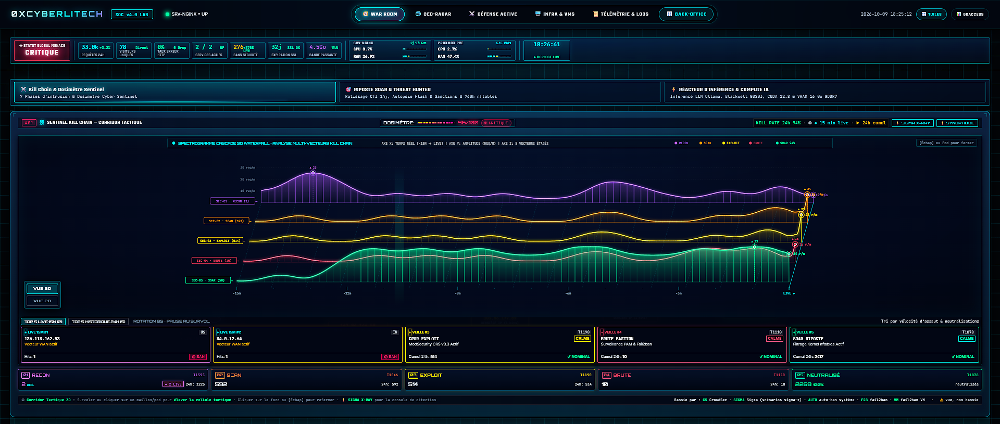
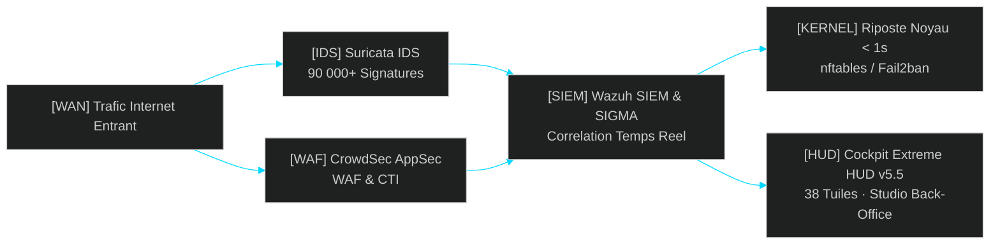
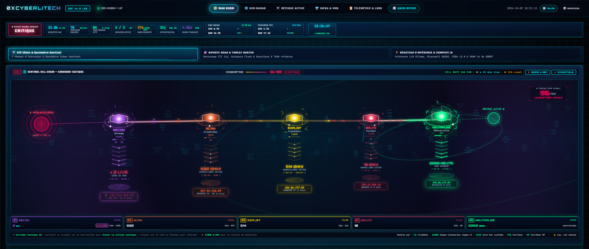
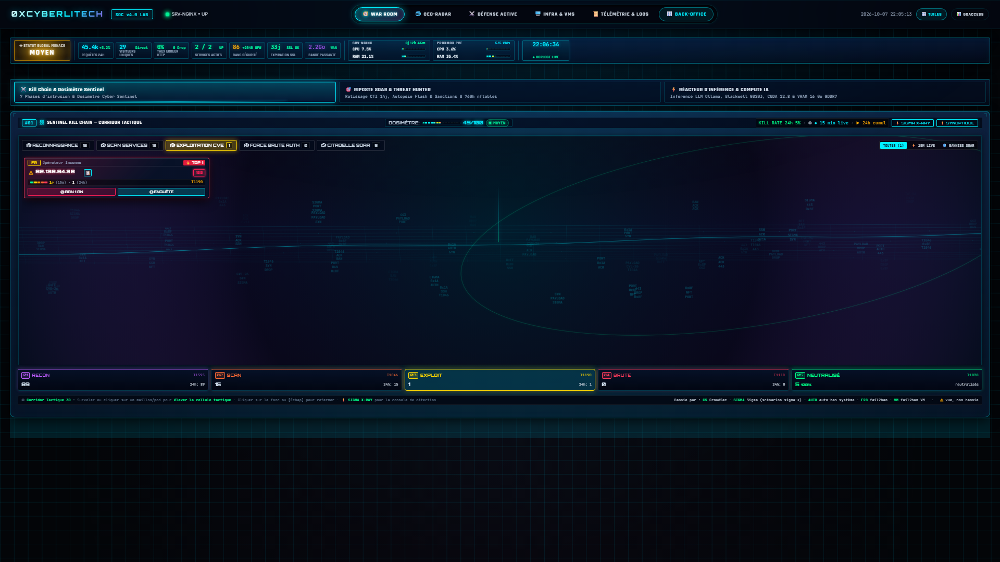
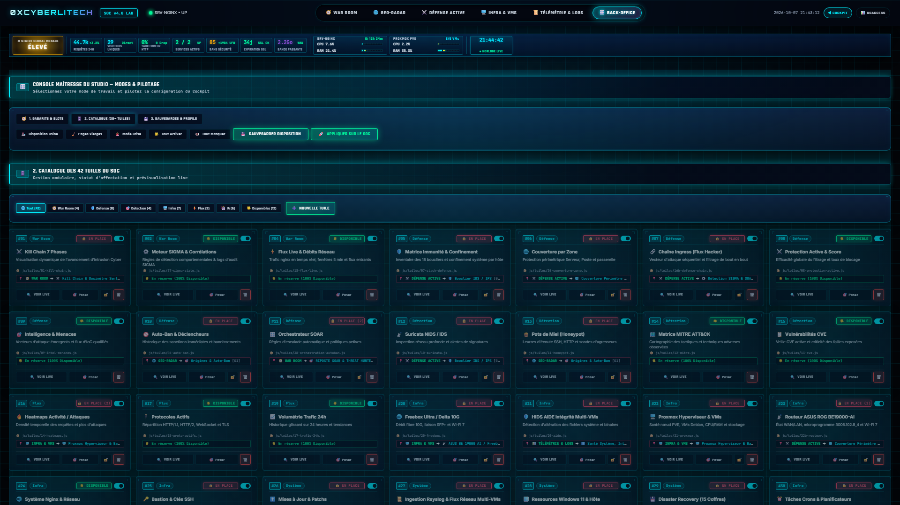
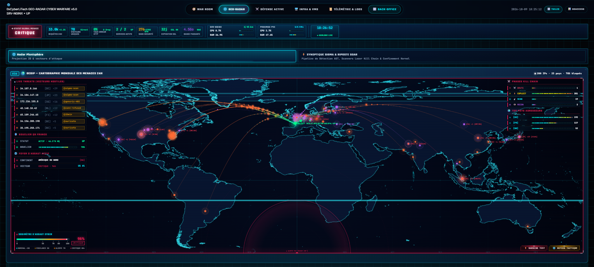
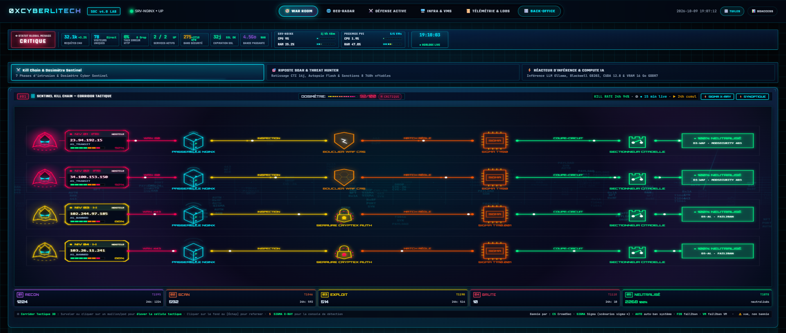
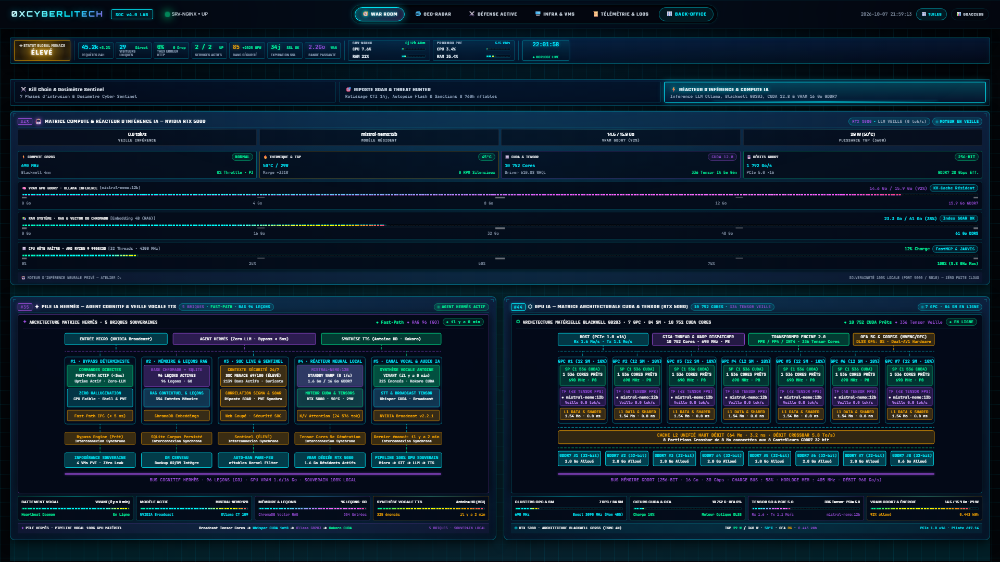
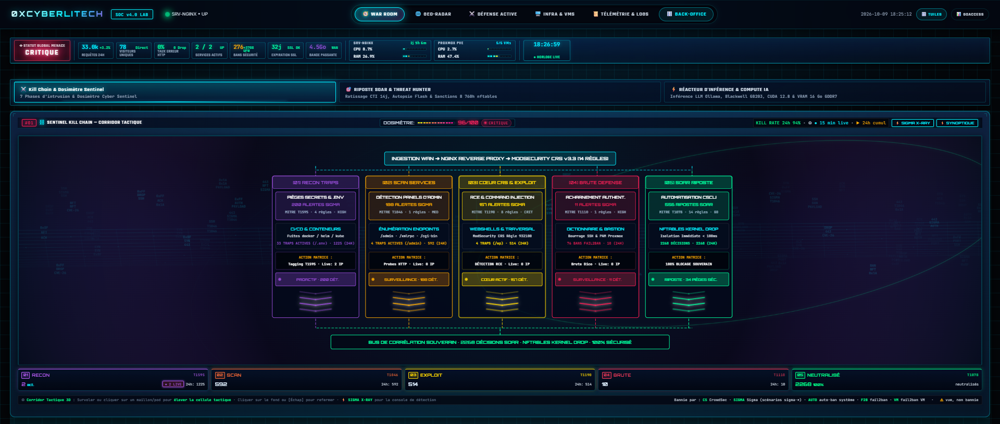
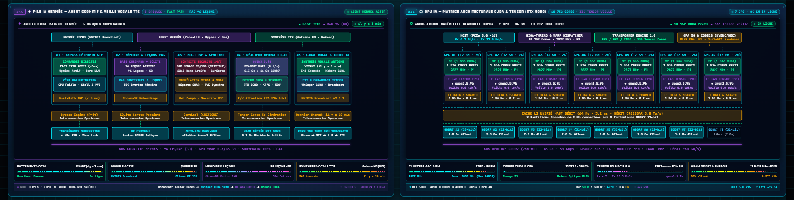

<!-- MASTER-HEADER-START -->

  
  
  
  

<!-- MASTER-HEADER-END -->

> [!IMPORTANT]
> **Vitrine Technologique & Tremplin R&D (`0xcyberlitech.com`)**
> Ce dépôt présente un **aperçu visuel et architectural** du **SOC Cockpit Extreme HUD v5.5** (38 tuiles télémétriques temps réel, défense en profondeur 24h/24) conçu et opéré au sein de l'Atelier **0xCyberLiTech**.
> L'étude d'ingénierie complète, la matrice des 38 tuiles, la chaîne de riposte noyau et l'architecture des 19 gardiens CI/CD sont publiées sur le portail officiel :
> - [**Livre Blanc R&D : Architecture du SOC Cockpit Extreme HUD v5.5**](https://0xcyberlitech.com/soc-rd.html)
> - [**Portail Souverain 0xCyberLiTech : Vue d'ensemble du Double Sanctuaire**](https://0xcyberlitech.com/)

---

##  01 // POSTE DE COMMANDEMENT WAR ROOM — EXTREME HUD v5.5 (38 TUILES)

*Cockpit tactique War Room Extreme HUD v5.5 en production réelle 24h/24 : dosimètre Sentinel instantané, cinématique Kill Chain MITRE ATT&CK, télémétrie sub-200 ms et zéro dépendance NPM.*

---

##  02 // LES 4 INFRANCHISSABLES DU SOC COCKPIT v5.5

| Pilier Architectural | Spécification en Production | Approfondissement |
|:---|:---|:---:|
| **01 · Défense Active Exposée 24/7** | Corrélation temps réel **Suricata IDS** (90 000+ signatures ET Open), **CrowdSec AppSec WAF**, **Wazuh SIEM** et **Fail2ban** avec bannissement noyau sub-seconde. |  |
| **02 · Architecture 38 Tuiles & Studio Back-Office** | **38 tuiles télémétriques** réparties sur **5 pages et 13 sous-onglets**, gouvernées par le **Studio Back-Office** à grille aimantée et 10 gabarits maîtres (`G-1` à `G-10`). |  |
| **03 · Dette Technique Zéro (`<= 400 Lignes`)** | Code **100 % Vanilla JS ES2024 / CSS3** sans aucune dépendance NPM. Chaque module respecte strictement le plafond de `400` lignes vérifié par AST. |  |
| **04 · Armure Qualité : 19 Gardiens & Edge E2E** | **19 Gardiens déterministes CI/CD** doublés de bancs hostiles sous **Microsoft Edge Headless réel** (audit géométrique DOM, parité Studio ↔ Cockpit, résilience sinistre `< 5 min`). |  |

---

##  03 // APERÇU VISUEL DES MODULES TACTIQUES (CAPTURES RETINA 2X)

| **Corridor Tactique Kill Chain 2D/3D** | **Élévation Isométrique 3D & Télémétrie** |
|:---:|:---:|
|  |  |
| *Qualification instantanée du niveau de menace, phases MITRE ATT&CK et riposte pare-feu.* | *Projection volumétrique des flux d'inspection, bargraphes LED normalisés et télémétrie temps réel.* |

| **Studio Back-Office & Catalogue des 38 Tuiles** | **Géo-Radar Vectoriel & Traçage Balistique** |
|:---:|:---:|
|  |  |
| *Configuration souveraine des étagères, du catalogue des 38 tuiles et des 10 gabarits maîtres.* | *Projection cartographique temps réel des vecteurs d'attaque, ASN hostiles et blocages.* |

<b>Afficher les vues complémentaires (Synoptique d'Attaque SIGMA, Matrice IA & GPU)</b>

 

| **Synoptique Dynamique d'Attaque & Rayons X SIGMA** | **Couplage Neuronal JARVIS × SOC & Tuiles GPU** |
|:---:|:---:|
|  |  |
|  |  |

---

##  04 // EXPLORER L'ÉTUDE COMPLÈTE SUR 0XCYBERLITECH.COM

- **Livre Blanc R&D SOC Cockpit v5.5 :** [https://0xcyberlitech.com/soc-rd.html](https://0xcyberlitech.com/soc-rd.html)
- **Livre Blanc R&D JARVIS Mark-VII :** [https://0xcyberlitech.com/jarvis-rd.html](https://0xcyberlitech.com/jarvis-rd.html)
- **Blueprint Matériel RTX 5080 Blackwell :** [https://0xcyberlitech.com/blueprint-jarvis.html](https://0xcyberlitech.com/blueprint-jarvis.html)

<!-- MASTER-FOOTER-START -->

<b>Architecturé &amp; Forgé par Marc &amp; Antigravity (Google DeepMind)</b> &nbsp;·&nbsp; <a href="https://0xcyberlitech.com/"><b>0xcyberlitech.com</b></a> &nbsp;·&nbsp; <a href="https://0xcyberlitech.com/soc-rd.html">Architecture SOC Cockpit v5.5</a> &nbsp;·&nbsp; <a href="https://0xcyberlitech.com/jarvis-rd.html">Architecture JARVIS Mark-VII</a> &nbsp;·&nbsp; <a href="https://0xcyberlitech.com/blueprint-jarvis.html">Blueprint Matériel RTX 5080</a>

<!-- MASTER-FOOTER-END -->
